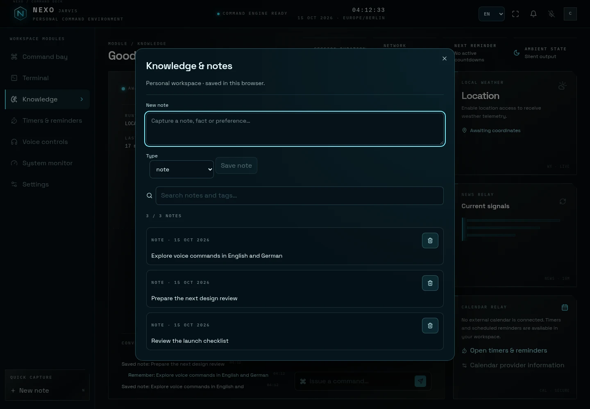

# Nexo Jarvis

### Dein Arbeitsbereich im Zentrum des Reaktors.

Ein persönlicher Assistent für Notizen, Timer, Erinnerungen, Sprachbefehle und aktuelle Informationen. Nexo verbindet einen reaktiven 3D-Fusionskern mit einem praktischen Arbeitsbereich – auf Deutsch und Englisch, mit derselben Befehlsverarbeitung im Browser und auf dem Node.js-Server.

**Alpha** · React 19 · TypeScript · Three.js · English / Deutsch

[Live-Demo öffnen](https://pierreg99.github.io/Nexo-Jarvis-AI-Futuristic-Assistant-Alpha/) · [English](README.md) · [Schnellstart](#schnellstart) · [Beispielbefehle](#befehle-ausprobieren) · [Deployment](#deployment-und-datenspeicherung)


_Die aktuelle Desktop-Oberfläche im lokalen Browserbetrieb. Für die eingebauten Befehle benötigt die statische Demo weder Konto noch KI-Schlüssel._

## Den Arbeitsbereich entdecken

| Modul                        | Möglichkeiten                                                                                                |
| ---------------------------- | ------------------------------------------------------------------------------------------------------------ |
| **Befehlszentrale**          | Befehle eingeben oder sprechen, Gespräche verfolgen sowie Wetter und Schlagzeilen abrufen.                   |
| **Wissen**                   | Notizen speichern, durchsuchen und löschen; Löschungen rückgängig machen.                                    |
| **Timer & Erinnerungen**     | Countdowns sowie einmalige oder wiederkehrende Erinnerungen erstellen, pausieren, fortsetzen und abbrechen.  |
| **Terminal & Systemmonitor** | Ergebnisse, Ausführungsverläufe, Berechtigungen und Audit-Protokolle prüfen.                                 |
| **Sprachsteuerung**          | Eine Browserstimme auswählen, die Sprachausgabe anpassen und deutsche oder englische Spracherkennung nutzen. |
| **Einstellungen**            | Sprache wählen, Standort konfigurieren und Einstellungen sowie Berechtigungen verwalten.                     |

### Ein Reaktor, der reagiert

Der Fusionskern reagiert auf **Bereitschaft, Zuhören, Nachdenken und Sprechen**. Bewegte Plasmaströme, kreisende Partikel, Magnetfeldringe und wechselndes Licht geben jedem Zustand einen eigenen Rhythmus.

- Durch Ziehen drehen; mit dem Mausrad oder einer Zwei-Finger-Geste zoomen. Die manuelle Kamerasteuerung bleibt bis zum nächsten Zustandswechsel erhalten.
- Die immersive Ansicht für einen genaueren Blick öffnen oder die Kamera über die Zurücksetzen-Schaltfläche zurücksetzen.
- Partikelströme wechseln ihre Geschwindigkeit sanft und ohne Positionssprünge.
- Die Einstellung für reduzierte Bewegung wird berücksichtigt. Bei fehlendem WebGL oder beim Start mit reduzierter Bewegung erscheint eine leichtere 2D-Ansicht.


### Notizen, Einstellungen und Smartphone

| Wissen · Englisch                                                                                                 | Einstellungen · Deutsch                                                             |
| ----------------------------------------------------------------------------------------------------------------- | ----------------------------------------------------------------------------------- |
|  |  |

<p align="center">
  
</p>

_Neue Aufnahmen der laufenden Anwendung. Die Notizen sind Beispieldaten; Wetter und Nachrichten hängen von Standort, Netzwerkzugriff und öffentlichen Diensten ab. [Details zu den Screenshots](docs/screenshots/README.md)._

## Schnellstart

Voraussetzung: **Node.js 22 oder neuer** und die in [`package.json`](package.json) festgelegte pnpm-Version.

```bash
git clone https://github.com/Pierreg99/Nexo-Jarvis-AI-Futuristic-Assistant-Alpha.git
cd Nexo-Jarvis-AI-Futuristic-Assistant-Alpha
corepack enable
corepack pnpm install --frozen-lockfile
corepack pnpm dev
```

Öffne die lokale Adresse, die der Entwicklungsserver ausgibt. Eingebaute Befehle funktionieren ohne KI-Schlüssel und ohne Datenbank. Optionale Servereinstellungen stehen in [`.env.example`](.env.example); kopiere die Datei bei Bedarf nach `.env`.

### Die erste Minute

1. In der Kopfzeile **EN** oder **DE** wählen. Bei der ersten Nutzung übernimmt Nexo die Browsersprache.
2. `Merke dir: Startliste prüfen` eingeben und die Notiz im Modul **Wissen** öffnen.
3. `Stelle einen Timer auf 5 Minuten` eingeben und ihn unter **Timer & Erinnerungen** verwalten.
4. Den Reaktor erkunden oder die Spracheingabe aktivieren, sofern der Browser Spracherkennung unterstützt.

## Befehle ausprobieren

| Englisch                                | Deutsch                                    | Funktion                                 |
| --------------------------------------- | ------------------------------------------ | ---------------------------------------- |
| `Remember: review the launch checklist` | `Merke dir: Startliste prüfen`             | Notiz speichern                          |
| `Read my notes`                         | `Zeige meine Notizen`                      | Notizen auflisten                        |
| `Find notes about launch`               | `Suche Notizen zu Start`                   | Notizen durchsuchen                      |
| `Set a 5 min timer for tea`             | `Stelle einen Timer auf 5 Minuten`         | Countdown starten                        |
| `Remind me in 1 hour to stretch`        | `Erinnere mich in 1 Stunde ans Dehnen`     | Einmalige Erinnerung anlegen             |
| `Remind me every 30 minutes to stretch` | `Erinnere mich alle 30 Minuten ans Dehnen` | Wiederkehrende Erinnerung anlegen        |
| `Show timers`                           | `Zeige Timer`                              | Aktive Aufgaben auflisten                |
| `Weather` / `News`                      | `Wetter` / `Nachrichten`                   | Aktuelle öffentliche Daten abrufen       |
| `System status` / `Help`                | `Systemstatus` / `Hilfe`                   | Arbeitsbereich prüfen / Befehle anzeigen |

Timer unterstützen Sekunden, Minuten, Stunden und kombinierte Zeitspannen bis zu sieben Tagen. Genaue Termine und wiederkehrende Intervalle lassen sich im Modul **Timer & Erinnerungen** festlegen. Fällige Aufgaben erscheinen im Benachrichtigungsbereich; Desktop-Benachrichtigungen sind optional.

## Die passende Betriebsart wählen

|                                | Browser / statisches Hosting                                               | Node.js-Server                                                          |
| ------------------------------ | -------------------------------------------------------------------------- | ----------------------------------------------------------------------- |
| Eingebaute Befehlsverarbeitung | Läuft im Browser                                                           | Läuft auf dem Server                                                    |
| Datenspeicherung               | `localStorage` im aktuellen Browserprofil                                  | Arbeitsbereichdateien in `NEXO_DATA_DIR`                                |
| Timer und Erinnerungen         | Prüfung bei geöffneter Seite und beim erneuten Öffnen                      | Planung durch den laufenden Serverprozess                               |
| Optionale KI-Gespräche         | Nicht verfügbar                                                            | OpenAI-kompatibler oder vorhandener Manus-Anbieter                      |
| Typischer Einsatz              | Demo ausprobieren oder einen statischen persönlichen Arbeitsbereich hosten | Einen persistenten persönlichen Assistenten mit optionaler KI betreiben |

Browser und Server verwenden getrennte Speicher; ein Wechsel synchronisiert keine Notizen. Das Löschen der Website-Daten entfernt den lokalen Arbeitsbereich. In beiden Betriebsarten sind externe Kalenderanbieter noch nicht verbunden.

## Standort, natürliche Stimmen und Kontosynchronisierung

- **Standort:** Stadt oder Postleitzahl suchen, Koordinaten eingeben oder den Standort ausdrücklich freigeben. Die Stadtsuche benötigt keinen API-Schlüssel. Android Alpha 2 unterstützt die ungefähre Standortberechtigung.
- **Natürliche Stimmen:** Browserstimmen oder serverseitig eingerichtete OpenAI-/ElevenLabs-Stimmen auswählen. Anbieterschlüssel bleiben auf dem Server; natürliche Stimmen setzen standardmäßig eine Anmeldung voraus.
- **OAuth und Synchronisierung:** Auf dem Node-Server mit Google oder Microsoft anmelden, um denselben Arbeitsbereich auf mehreren Geräten zu nutzen. Sichtbare Ansichten aktualisieren sich alle zehn Sekunden. Ein Import von Notizen vor der Anmeldung ist ausdrücklich auswählbar.
- **Leistung:** Instanzierte Turbinenschaufeln, statische Reflexionen, pausierte Hintergrundansichten sowie automatische Qualität, Energiesparmodus und hohe Details. Im kontrollierten Rendering-Check wurden rund 59 % weniger Draw Calls und 85 % weniger Dreiecke pro Bild übermittelt.

[Einrichtung von Anbietern und OAuth](docs/PROVIDERS.md) · [Messmethode und Qualitätsmodi](docs/PERFORMANCE.md). Diese technischen Anleitungen werden auf Englisch gepflegt.

## Android-APK

Die Android-Alpha bündelt diese Oberfläche und die lokale Befehlsverarbeitung in einer WebView-App für **Android 8.0 oder neuer**. Notizen und Einstellungen werden auf dem Gerät gespeichert. Wetter und Nachrichten benötigen weiterhin Internetzugriff.

```bash
corepack pnpm android:build
```

Dafür werden JDK 21 und Android SDK 35 benötigt. Das Ergebnis liegt unter `artifacts/nexo-jarvis-1.0.0-alpha.2-debug.apk`. Der [Android-Workflow](https://github.com/Pierreg99/Nexo-Jarvis-AI-Futuristic-Assistant-Alpha/actions/workflows/android.yml) stellt nach einem erfolgreichen Lauf außerdem APK, Prüfsumme und Lint-Bericht als Download bereit.

Dies ist eine mit einem Debug-Schlüssel signierte Alpha. Native Spracheingabe, Hintergrundalarme, native Benachrichtigungen und eine Serverauswahl sind noch nicht enthalten. [Build, Installation und Grenzen](docs/ANDROID.md).

## Optionale KI-Gespräche

Richte einen Anbieter auf einem privaten Node.js-Server über Umgebungsvariablen ein:

```dotenv
OPENAI_API_KEY=your-server-side-key
OPENAI_BASE_URL=https://api.openai.com/v1
NEXO_AI_MODEL=gpt-4.1-mini
```

KI-Gespräche sind standardmäßig auf angemeldete Benutzer beschränkt. Auf einem privaten Server ohne OAuth lassen sie sich mit `NEXO_AI_ALLOW_GUESTS=true` für Besucher aktivieren. Für öffentliche Installationen sollte der Zugriff authentifiziert sein. Bei KI-Gesprächen werden die jüngsten Gesprächseinträge und passende gespeicherte Notizen an den eingerichteten Anbieter übertragen. Notizen, Timer und andere Befehle laufen weiterhin über Nexo und seine validierten Tools.

Ein vorhandener Manus-Anbieter lässt sich mit `BUILT_IN_FORGE_API_KEY` und `BUILT_IN_FORGE_API_URL` konfigurieren.

## Deployment und Datenspeicherung

### Node.js-Server

```bash
corepack pnpm check
corepack pnpm test
corepack pnpm build
corepack pnpm start
```

Der Server stellt `/api/health` und die Arbeitsbereich-API unter `/api/trpc` bereit. Über `NEXO_DATA_DIR` lässt sich das Verzeichnis für Arbeitsbereichdateien festlegen; Standard ist `.nexo-data/`. Bewahre es auf persistentem Speicher auf und nimm es in Backups auf. Dateispeicherung und Erinnerungsplaner sind für einen einzelnen Node.js-Prozess ausgelegt. Installationen mit mehreren Instanzen benötigen gemeinsamen Speicher und einen koordinierten Planer.

### Statisches Hosting

GitHub-Pages-Builds verwenden automatisch den Repository-Pfad. Für einen manuellen Build dieser Pages-Adresse:

```bash
VITE_BASE_PATH=/Nexo-Jarvis-AI-Futuristic-Assistant-Alpha/ corepack pnpm build
```

Der statische Betrieb nutzt dieselbe Befehlslogik und `localStorage` im Browser. Er hat keine Server-API und keinen serverseitigen KI-Anbieter. Für Browser-Erinnerungen muss die Seite geöffnet bleiben. Ein geschlossener oder pausierter Browser kann nicht geweckt werden. Beim nächsten Öffnen prüft Nexo deshalb überfällige Aufgaben.

## Architektur

| Verzeichnis                                | Aufgabe                                                                          |
| ------------------------------------------ | -------------------------------------------------------------------------------- |
| [`client/src/`](client/src/)               | React-Oberfläche, Sprachsteuerung, Browserintegration und Three.js-Reaktor       |
| [`shared/nexo/`](shared/nexo/)             | Befehlsverarbeitung, Schemas, Tool-Registry, Notizen, Timer und Erinnerungen     |
| [`shared/i18n.ts`](shared/i18n.ts)         | Englische und deutsche Übersetzungen sowie lokalisierte Formatierung             |
| [`server/`](server/)                       | Node.js-API, persistente Arbeitsbereiche, Zeitplanung und optionale KI-Anbindung |
| [`.github/workflows/`](.github/workflows/) | Typprüfung, Tests, Produktionsbuilds und GitHub-Pages-Deployment                 |

Tools haben die Berechtigungsstufen `read`, `write` oder `high-risk`. Im Nur-Lesen-Modus sind Schreibzugriffe gesperrt. Hochriskante Tools erfordern eine zusätzliche Bestätigung; die öffentliche Assistant-API akzeptiert nur Lese- und Schreibtools. Antworten aus KI-Gesprächen können keine Tools ausführen.

## Entwicklungsprüfungen

```bash
corepack pnpm check   # TypeScript
corepack pnpm test    # Tests
corepack pnpm build   # Produktionsbuilds für Client und Server
```

Dieselben Prüfungen laufen in den Qualitäts- und Pages-Workflows. Änderungen an sichtbaren Texten sollten Deutsch und Englisch berücksichtigen. Bei visuellen Änderungen Desktop, Smartphone und reduzierte Bewegung prüfen; die [Screenshot-Galerie](docs/screenshots/README.md) bei Änderungen an der sichtbaren Oberfläche aktualisieren.

## Aktuelle Grenzen

- **Sprache und Benachrichtigungen:** Die Verfügbarkeit hängt von Browserfunktionen und Berechtigungen ab. Die Texteingabe bleibt verfügbar.
- **Aktuelle Informationen:** Wetter benötigt einen Standort; Wetter und Nachrichten benötigen Netzwerkzugriff auf öffentliche Dienste.
- **Browser-Erinnerungen:** Ein geschlossener oder pausierter Browser kann sich nicht selbst wecken. Überfällige Aufgaben werden beim erneuten Öffnen geprüft.
- **Datenspeicherung:** Serverdateien sichern. Die aktuelle Dateispeicherung und Zeitplanung sind für einen einzelnen Node.js-Prozess ausgelegt.
- **KI-Gespräche:** Optional und serverseitig; bei Nutzung werden jüngste Gesprächseinträge und passende Notizen an den eingerichteten Anbieter übertragen.
- **Kalender:** Die Oberfläche beschreibt Anbieteroptionen, externe Kalender sind jedoch noch nicht verbunden.

## Projektdokumentation

[Änderungsprotokoll](CHANGELOG.md) · [Aktueller Plan](PLAN.md) · [Übergabe](HANDOVER.md) · [Android-Anleitung](docs/ANDROID.md)

Plan, Übergabe und technische Android-Anleitung werden derzeit auf Englisch gepflegt.
