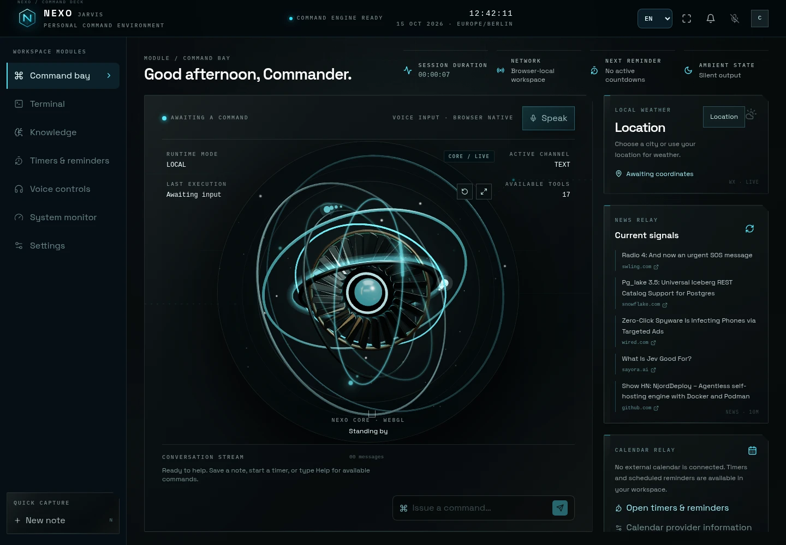
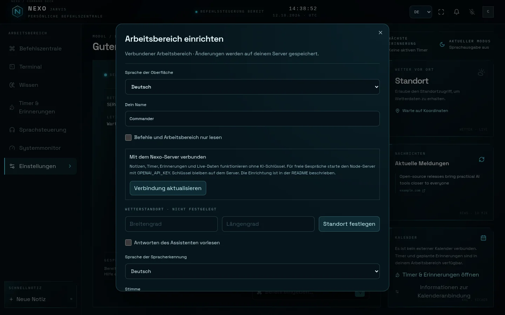
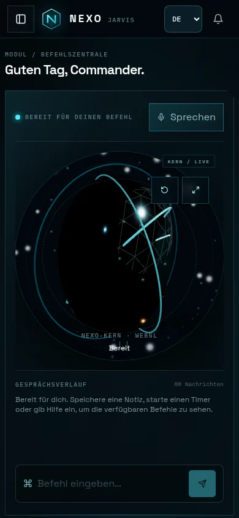

# Nexo Jarvis

**A personal command bay for notes, timers, reminders, voice input, and live information.** Nexo combines an orbital interface with one permission-checked assistant engine for the browser and Node.js.

[English](README.md) · [Deutsch](README.de.md) · [Open the live demo](https://pierreg99.github.io/Nexo-Jarvis-AI-Futuristic-Assistant-Alpha/)

## Screenshots

| Command bay · English | Workspace settings · Deutsch |
| --- | --- |
|  |  |

**Phone layout · Deutsch**



## What it does

- Save, search, and delete notes, with undo for deletions.
- Run countdowns and one-time or recurring reminders. Pause, resume, cancel, and review them from the workspace.
- See in-app notifications for completed tasks, with optional desktop notifications while Nexo is open.
- Inspect tool permissions, results, traces, and audit history in the terminal and system monitor.
- Use browser speech recognition in English or German, choose a voice, and adjust spoken output.
- Check current weather and headlines; configure location in settings.
- Add an optional server-side OpenAI-compatible conversation provider. Provider keys stay on the server, and assistant replies cannot run tools.
- Switch the interface between English and German. Nexo follows the browser language on first use and remembers the selection in the browser.

## Get started

Use Node.js **22 or newer** and the pnpm version pinned in `package.json`:

```bash
corepack enable
corepack pnpm install --frozen-lockfile
corepack pnpm dev
```

Open the local URL printed by the development server. Notes, timers, reminders, voice features, and public live data work without an AI key or database. In browser-only mode, the workspace is stored in that browser profile.

### Example commands

| English | Deutsch | Result |
| --- | --- | --- |
| `Remember: review the launch checklist` | `Merke dir: Startliste prüfen` | Save a note |
| `Read my notes` | `Zeige meine Notizen` | List saved notes |
| `Find notes about launch` | `Suche Notizen zu Start` | Search notes |
| `Set a 5 min timer for tea` | `Stelle einen Timer auf 5 Minuten` | Start a countdown |
| `Remind me in 1 hour to stretch` | `Erinnere mich in 1 Stunde ans Dehnen` | Add a one-time reminder |
| `Remind me every 30 minutes to stretch` | `Erinnere mich alle 30 Minuten ans Dehnen` | Add a recurring reminder |
| `Show timers` | `Zeige Timer` | List active tasks |
| `Weather` / `News` | `Wetter` / `Nachrichten` | Read current public data |
| `System status` / `Help` | `Systemstatus` / `Hilfe` | Inspect the workspace / list commands |

Timers accept seconds, minutes, hours, and combined durations up to seven days. Exact calendar dates and recurring intervals can also be configured in **Timers & reminders**.

### Optional AI conversations

Configure a provider on a private Node.js server using environment variables:

```dotenv
OPENAI_API_KEY=your-server-side-key
OPENAI_BASE_URL=https://api.openai.com/v1
NEXO_AI_MODEL=gpt-4.1-mini
```

AI conversations require a signed-in user by default. On a private server without OAuth, `NEXO_AI_ALLOW_GUESTS=true` enables them for visitors to that server. Use authenticated access for a public deployment. Recent conversation entries and relevant saved notes are sent to the configured provider when you use AI chat; notes, timers, and other commands continue to use Nexo's validated tool engine.

An existing Manus provider can be configured with `BUILT_IN_FORGE_API_KEY` and `BUILT_IN_FORGE_API_URL`.

## Deploy and store data

### Node.js server

```bash
corepack pnpm check
corepack pnpm test
corepack pnpm build
corepack pnpm start
```

The server exposes `/api/health` and the workspace API at `/api/trpc`. Set `NEXO_DATA_DIR` to choose the directory for workspace files; the default is `.nexo-data/`. Keep this directory on persistent storage and include it in backups. File-backed storage and the reminder scheduler are intended for one Node.js process. Multi-instance deployments need shared storage and a coordinated scheduler.

### Static hosting

GitHub Pages builds set the repository base path automatically. To build for this repository's Pages URL manually:

```bash
VITE_BASE_PATH=/Nexo-Jarvis-AI-Futuristic-Assistant-Alpha/ corepack pnpm build
```

Static mode uses the same command engine and browser `localStorage`; it has no server API or server-side AI provider. Browser reminders need the page to be open. A closed or suspended browser cannot wake for a reminder, so Nexo checks overdue tasks when you reopen it.

## How it is built

`shared/nexo/` contains the command engine, schemas, tool registry, notes, timers, and reminders. The client uses it directly in browser mode; the Node server runs the same engine with isolated, persistent workspaces. `shared/i18n.ts` provides English and German copy, and date formatting follows the selected language.

Tools declare `read`, `write`, or `high-risk` permissions. Read-only mode blocks writes. High-risk tools need extra confirmation, and the public assistant API only accepts read and write tools. External calendar providers are not connected yet; browser speech, geolocation, and desktop notifications depend on browser support and permissions.
